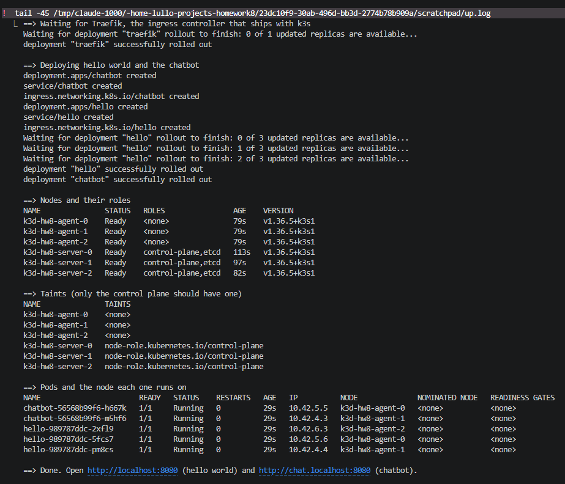
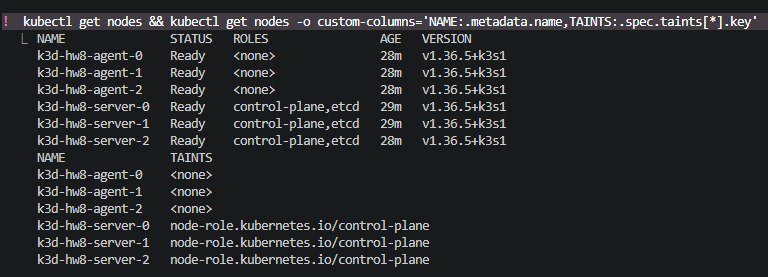
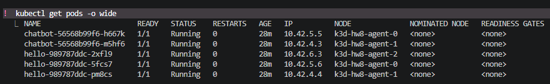
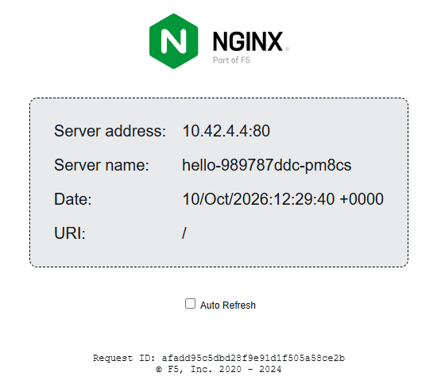
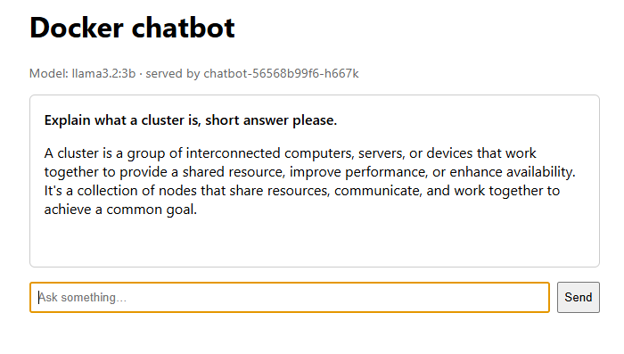

# k3s HA Cluster: Three Control-Plane Nodes and Three Workers with k3d

A six-node k3s cluster on one laptop, created by a single script. Three control-plane nodes with embedded etcd and three workers, each node a Docker container running k3s, managed by [k3d](https://k3d.io). On the cluster run a hello-world site and the chatbot from [homework 7](https://github.com/Lullow/docker-chatbot), pulled as an image from GHCR. Both are reachable from the browser on `localhost:8080`.

**Key points**
- **Everything is scripted.** `./up.sh` installs k3d in a pinned version, creates the cluster from `cluster.yaml` and deploys `k8s/`. `./down.sh` removes it all. `kubectl` is only used to wait and to look.
- **No node has two roles.** k3s lets its servers run workloads by default. Here they carry the taint `node-role.kubernetes.io/control-plane:NoSchedule`, so the pods land on the three workers only.
- **The control plane survives the loss of a server.** Three servers give etcd a quorum. Stop one and `kubectl` and the web pages keep answering (see [Lose a control-plane node](#lose-a-control-plane-node)).
- **The image from homework 7 is used unchanged.** This repository only points at `ghcr.io/lullow/docker-chatbot:v1`. The pod reaches Ollama on the host through `host.k3d.internal`.
- **Pinned versions.** k3d v5.9.0 with checksum verification, and `rancher/k3s:v1.36.5-k3s1`.

## Contents
1. [How it works](#how-it-works)
2. [Prerequisites](#prerequisites)
3. [Bring the cluster up](#bring-the-cluster-up)
4. [Verify](#verify)
5. [Lose a control-plane node](#lose-a-control-plane-node)
6. [Tear down](#tear-down)
7. [Screenshots](#screenshots)
8. [Limitations](#limitations)

The plan written before building, with the options considered, is in [docs/plan.md](docs/plan.md).

## How it works

```
browser  http://localhost:8080          Windows; Docker Desktop publishes the port
   │
   ▼
k3d-hw8-serverlb                        nginx container: port 80 → all six nodes, 6443 → the servers
   │
   ▼
port 80 on a node                       svclb-traefik, the k3s ServiceLB DaemonSet on every node
   │
   ▼
Traefik                                 the ingress controller that ships with k3s, on a worker
   │   no host        → hello
   │   chat.localhost → chatbot
   ▼
Service → Pod                           hello (3 pods) or chatbot (2 pods), workers only
   │
   ▼  chatbot only
host.k3d.internal:11434                 Ollama on the host, OpenAI-compatible API
```

| Node | Role | Taint | What runs there |
|---|---|---|---|
| `k3d-hw8-server-0..2` | control-plane, etcd | `node-role.kubernetes.io/control-plane:NoSchedule` | API server, etcd, and the k3s add-ons that tolerate the taint: CoreDNS, metrics-server, local-path-provisioner, ServiceLB |
| `k3d-hw8-agent-0..2` | worker | none | Traefik, hello, chatbot, ServiceLB |
| `k3d-hw8-serverlb` | not a node | | nginx in front of the cluster: `127.0.0.1:8080 → 80`, `127.0.0.1:6550 → 6443` |

| File | Purpose |
|---|---|
| `cluster.yaml` | k3d config: 3 servers, 3 agents, pinned k3s image, the taint on the servers, ports 8080 and 6550, a fixed subnet so that the servers keep their IPs across restarts |
| `up.sh` | Installs k3d if missing, creates the cluster, or restarts it in the right order if it exists but does not answer, waits for the nodes and Traefik, applies `k8s/`, prints the result. Safe to re-run |
| `down.sh` | Deletes the cluster and its containers, switches kubectl back to the Docker Desktop context if there is one |
| `k8s/hello.yaml` | `nginxdemos/hello:0.4`, three pods spread over the workers, a Service and the default Ingress |
| `k8s/chatbot.yaml` | The homework 7 image, two pods, a Service and an Ingress for `chat.localhost` |
| `docs/plan.md` | The plan: constraints, options considered, design, verification and outcome |

## Prerequisites

- Docker Desktop with the WSL 2 integration. Tested with Docker 29.7 on Windows 11 Home; the scripts run in WSL (Ubuntu 24.04).
- `kubectl`, tested with v1.36.1. k3d itself is installed by `up.sh` into `~/.local/bin`, no sudo needed.
- For the chatbot: Ollama on the host with the model pulled, `ollama pull llama3.2:3b`. Hello world works without it.
- About 2.5 GB of free RAM for the six nodes.

## Bring the cluster up

```bash
./up.sh
```

The script checks for `docker` and `kubectl`, downloads k3d v5.9.0 and verifies its SHA-256 checksum, creates the cluster from `cluster.yaml`, waits until all six nodes are Ready and Traefik has rolled out, applies `k8s/` and waits for both deployments. It ends by printing the nodes with their taints and the pods with the node each one runs on. The first run takes about two minutes, most of it pulling images. If the cluster already exists and answers, the script only re-applies the manifests. If it exists but does not answer, which is what happens after Docker Desktop has been restarted, the script stops it and starts it again in the right order (see [Limitations](#limitations)). Either way it is safe to run again.

## Verify

```bash
kubectl get nodes
```
```
NAME               STATUS   ROLES                AGE     VERSION
k3d-hw8-agent-0    Ready    <none>               115s    v1.36.5+k3s1
k3d-hw8-agent-1    Ready    <none>               115s    v1.36.5+k3s1
k3d-hw8-agent-2    Ready    <none>               115s    v1.36.5+k3s1
k3d-hw8-server-0   Ready    control-plane,etcd   2m32s   v1.36.5+k3s1
k3d-hw8-server-1   Ready    control-plane,etcd   2m16s   v1.36.5+k3s1
k3d-hw8-server-2   Ready    control-plane,etcd   119s    v1.36.5+k3s1
```

Only the servers are tainted, and every workload pod runs on a worker:

```bash
kubectl get nodes -o custom-columns='NAME:.metadata.name,TAINTS:.spec.taints[*].key'
kubectl get pods -o wide
```
```
NAME                       READY   STATUS    RESTARTS   AGE   IP          NODE
chatbot-56568b99f6-887nz   1/1     Running   0          29s   10.42.5.3   k3d-hw8-agent-2
chatbot-56568b99f6-985kt   1/1     Running   0          29s   10.42.7.3   k3d-hw8-agent-1
hello-989787ddc-5lwft      1/1     Running   0          28s   10.42.7.4   k3d-hw8-agent-1
hello-989787ddc-9xf6h      1/1     Running   0          28s   10.42.4.6   k3d-hw8-agent-0
hello-989787ddc-bkl58      1/1     Running   0          28s   10.42.5.4   k3d-hw8-agent-2
```

`kubectl get pods -A -o wide` shows what the servers do run: CoreDNS, metrics-server and the local-path provisioner, which k3s gives a toleration for the taint, and one `svclb-traefik` pod per node. That DaemonSet is what makes port 80 answer on every node, which is why the k3d load balancer can forward to all six.

**In the browser.** `http://localhost:8080` shows the hello page with `Server name: hello-…`, the pod that answered; a refresh usually gives another one. `http://chat.localhost:8080` shows the chatbot, and the page says which pod served it. Browsers resolve `*.localhost` to 127.0.0.1 on their own. From the WSL terminal, set the `Host` header instead:

```bash
curl -s localhost:8080 | grep -o 'hello-[a-z0-9-]*'
curl -s -H 'Host: chat.localhost' localhost:8080/health
curl -s -H 'Host: chat.localhost' -H 'content-type: application/json' \
  -d '{"messages":[{"role":"user","content":"Answer in five words: what is Kubernetes?"}]}' \
  localhost:8080/chat
```
```
hello-989787ddc-bkl58
{"status":"ok","model":"llama3.2:3b","host":"chatbot-56568b99f6-887nz"}
{"reply":"Container orchestration platform software framework."}
```

The last answer came from Ollama on the host in about seven seconds, through `host.k3d.internal`, which k3d had resolved to `192.168.65.254`, the Docker Desktop host address.

## Lose a control-plane node

```bash
docker stop k3d-hw8-server-1
kubectl get nodes                                  # answers at once; after about a minute server-1 is NotReady
curl -s localhost:8080 | grep -o 'hello-[a-z0-9-]*'
docker start k3d-hw8-server-1
```

In the test the API answered in 0.1 s with one server down, both pages kept answering and `kubectl get --raw /readyz?verbose` reported `etcd ok`. Three etcd members keep their majority when one is lost; with two down the API would stop accepting writes. k3s cordons a server while it shuts down and uncordons it again when it starts, so the node may show `SchedulingDisabled` for a few seconds after the restart.

## Tear down

```bash
./down.sh
```

Removes the six nodes, the load balancer and the tools container, and the `k3d-hw8` kubeconfig context. It ends by listing the `k3d-` containers that are left, which should be none.

## Screenshots

**1. `./up.sh`.** The end of the run. The cluster is created, both apps are deployed, and the script prints the nodes, the taints and the pods. From no cluster to a working one in about two minutes.



**2. Nodes.** Three `control-plane,etcd` nodes and three workers, all Ready on the same k3s version. Only the servers carry the `node-role.kubernetes.io/control-plane` taint.



**3. Pods.** Every hello and chatbot pod runs on an agent. The topology spread constraint puts the three hello pods on three different workers.



**4. Hello world in the browser.** `http://localhost:8080` answered by `hello-989787ddc-pm8cs`, the pod on agent-1. The request took the path described in [How it works](#how-it-works): Windows, Docker Desktop, the k3d load balancer, Traefik, the Service and finally the pod.



**5. The chatbot in the browser.** `http://chat.localhost:8080` served by `chatbot-56568b99f6-h667k` on agent-0, with an answer from `llama3.2:3b` running in Ollama on the host, reached through `host.k3d.internal`.



## Limitations

- **Containers, not machines.** The six nodes share the host kernel and one Docker network. Scheduling, roles, taints and etcd quorum behave as on real nodes; isolation and failure of hardware do not.
- **One host.** The control plane is highly available, but everything runs on one laptop behind one nginx container. Stop Docker Desktop and the cluster is gone.
- **Ollama runs on the host,** not in the cluster. On a laptop CPU the 3B model answers in a few seconds, which is enough for a demo.
- **`*.localhost` is a browser convention.** Chrome, Edge and Firefox resolve it to 127.0.0.1; command-line tools need the `Host` header or `--resolve`.
- **ServiceLB pods run on the control-plane nodes too.** They tolerate the taint on purpose, so that every node accepts traffic on port 80. The workloads themselves stay on the workers.
- **A Docker restart does not bring the cluster back by itself.** Docker Desktop restarts the containers in an arbitrary order. k3d gives the servers static IPs from the subnet in `cluster.yaml`, but not the agents, so an agent that starts first can take a server's address and the servers never come up. `./up.sh` notices that the cluster does not answer, stops it and lets k3d start the servers before the agents. That takes about a minute.
